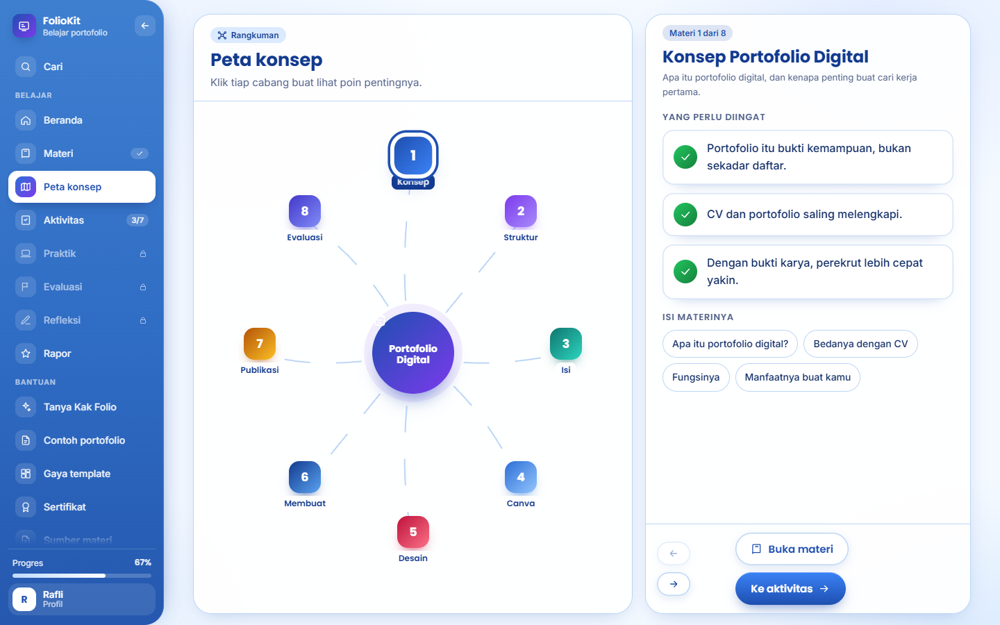
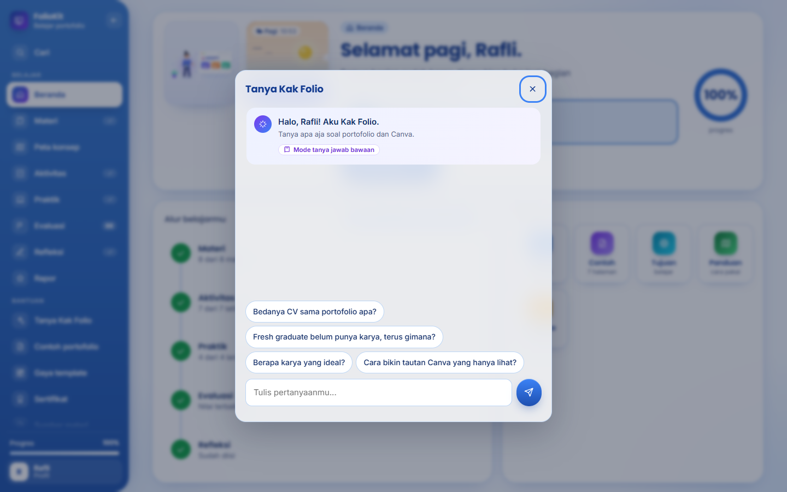

# FolioKit

Media belajar bikin portofolio digital pakai Canva, buat teman-teman fresh graduate yang baru mau mulai cari kerja.

Buka di sini: https://rafkalards.github.io/FolioKit/


## Tentang

Banyak fresh graduate punya karya, tapi bingung cara menyusunnya jadi portofolio yang enak dilihat perekrut. FolioKit kami bikin buat bantu itu, mulai dari kenalan sama portofolio sampai punya portofolio jadi di Canva.

Materinya dibagi jadi slide-slide pendek, ada contoh dan kuis kecil di tiap materi. Setelah itu ada latihan, praktik langsung di Canva, evaluasi, dan sertifikat buat yang lulus.

FolioKit dibuat untuk tugas mata kuliah Pengembangan Multimedia Pembelajaran, Prodi Teknologi Pendidikan, Universitas Negeri Jakarta, pakai model pengembangan Hannafin dan Peck.

## Tim

Kelompok 1, Teknologi Pendidikan A, Universitas Negeri Jakarta

| Nama | Peran |
| --- | --- |
| Arman Fadhilah | Project Manager |
| Bhimo Chrisandy | Desainer Instruksional |
| Rafli Putra Ardi | Desainer Instruksional |

## Alur belajar

Tiap tahap baru kebuka kalau tahap sebelumnya udah selesai, jadi belajarnya urut.

```
Intro → Tes awal → 8 Materi → Peta konsep → 7 Aktivitas → Praktik di Canva → Evaluasi → Refleksi → Rapor dan sertifikat
```

| Tahap | Isinya |
| --- | --- |
| Intro | Video pembuka 53 detik. |
| Tes awal | 8 soal buat lihat pemahaman awal. Nilainya nanti dibandingin sama evaluasi akhir. |
| Materi | 8 topik. Bisa dibaca model slide (Cerita) atau model ringkasan. |
| Peta konsep | Rangkuman semua materi dalam satu gambar. |
| Aktivitas | 7 latihan, boleh diulang sampai benar. |
| Praktik | 4 langkah bikin portofolio beneran di Canva, ada juga simulasinya. |
| Evaluasi | 8 soal akhir. |
| Refleksi | Menilai portofolio sendiri. |
| Rapor | Ringkasan progres, kenaikan nilai, lencana, dan sertifikat. |

## Materi

| No | Materi | Isinya |
| --- | --- | --- |
| 1 | Konsep Portofolio Digital | Apa itu portofolio digital dan kenapa penting buat cari kerja pertama. |
| 2 | Struktur Portofolio Digital | Lima bagian yang hampir selalu ada di portofolio yang enak dibaca. |
| 3 | Menentukan Isi Portofolio | Milih karya yang paling nyambung sama kerjaan yang diincar. |
| 4 | Mengenal Canva | Tampilan Canva dan fitur dasar yang bakal sering dipakai. |
| 5 | Prinsip Dasar Desain | Empat hal yang bikin portofolio kelihatan rapi tanpa harus jago desain. |
| 6 | Membuat Portofolio dengan Canva | Urutan kerja dari template kosong sampai portofolio siap diperiksa. |
| 7 | Publikasi Portofolio | Cek ulang, simpan, lalu bagikan ke orang yang tepat. |
| 8 | Evaluasi dan Perbaikan | Cara menilai portofolio sendiri lalu memperbaikinya satu per satu. |

Di tiap materi ada gambaran singkat, contoh, kartu bolak-balik, video, dan satu soal cek cepat.

## Aktivitas

1. Fungsi Portofolio
2. Susun Strukturnya
3. Pilih Karya yang Pas
4. Mana yang Lebih Enak Dibaca?
5. Cocokkan Istilah
6. Benar atau Salah
7. Urutkan Langkahnya

## Praktik di Canva

1. Pilih template yang udah rapi.
2. Ganti teks contoh dengan data diri sendiri.
3. Masukkan karya, bagian yang paling dilihat perekrut.
4. Rapikan tampilan: paling banyak dua jenis huruf, satu warna utama, jarak yang konsisten.

## Yang ada di dalamnya

- Contoh portofolio berbentuk buku 8 halaman, ada versi yang benar dan versi yang kurang tepat, lengkap dengan penjelasannya.
- Kak Folio, tempat tanya jawab soal portofolio dan Canva. Jawabannya udah disiapin, jadi tetap jalan tanpa internet.
- Sertifikat yang bisa diunduh kalau nilai evaluasi minimal 70.
- 8 lencana buat pencapaian tertentu.
- Contoh gaya template Canva.
- Tur singkat di tiap halaman buat pengguna baru.
- Menu di kiri. Di laptop sidebarnya bisa dilebarin atau diciutin, di HP menunya geser dari kiri.
- Beranda yang nunjukin langkah berikutnya, kira-kira berapa menit lagi, dan target kecil harian kalau mau.
- Progres kesimpan otomatis di browser dan bisa dicadangkan ke file buat dipindah ke HP atau laptop lain.
- Bisa dibuka tanpa internet setelah sekali dibuka online, dan bisa dipasang kayak aplikasi.
- Video diputar langsung di dalam web.
- Bisa dipakai pakai keyboard (panah kiri dan kanan buat ganti slide, Esc buat nutup jendela).

## Tampilan

| Beranda | Materi |
| --- | --- |
|  |  |

| Peta konsep | Aktivitas |
| --- | --- |
|  |  |

| Contoh aktivitas | Praktik di Canva |
| --- | --- |
|  |  |

| Rapor | Sertifikat |
| --- | --- |
|  |  |

| Contoh portofolio | Kak Folio |
| --- | --- |
|  |  |

Di HP:

<p>
  
  &nbsp;&nbsp;
  
</p>

## Cara pakai

### Online

Buka https://rafkalards.github.io/FolioKit/ di browser HP atau laptop.

### Tanpa internet

1. Buka link di atas sekali waktu ada internet. Materi, gambar, dan video intro otomatis kesimpan di browser.
2. Habis itu link yang sama tetap bisa dibuka walaupun lagi nggak ada sinyal, asal di HP atau laptop dan browser yang sama.
3. Biar lebih gampang, pasang sebagai aplikasi:
   - Android (Chrome): menu ⋮, lalu Tambahkan ke layar utama atau Instal aplikasi.
   - iPhone (Safari): tombol Bagikan, lalu Tambahkan ke Layar Utama.
   - Laptop (Chrome atau Edge): klik ikon pasang di ujung kanan kolom alamat.

Video YouTube, tombol Buka Canva, dan rujukan jurnal tetap butuh internet. Kalau lagi offline, bagian itu bakal ngasih tahu.

### Di komputer sendiri

```bash
git clone https://github.com/rafkalards/FolioKit.git
cd FolioKit
python -m http.server
```

Lalu buka `http://localhost:8000`.

## Buat yang mau ngedit

FolioKit dibuat pakai HTML, CSS, dan JavaScript biasa, tanpa framework dan tanpa proses build. Font Poppins dan Inter disimpan di folder `fonts/`. Ilustrasi 3D di halaman awal pakai Three.js (lisensi MIT) yang udah dipangkas, ada di folder `vendor/`.

```
FolioKit/
├── index.html          kerangka halaman
├── style.css           semua tampilan
├── script.js           semua logika dan isi materi
├── intro.mp4           video intro
├── intro-poster.jpg    sampul video intro
├── sw.js               penyimpan file buat mode offline
├── manifest.json       nama dan ikon aplikasi
├── fonts/              font Poppins dan Inter
├── icons/              ikon aplikasi
├── vendor/             Three.js versi ringkas
├── tests/              tes otomatis (Playwright)
├── package.json        bahan buat tes
├── CLAUDE.md           catatan proyek
└── docs/preview/       gambar buat README
```

Tes otomatis butuh Node.js dan Playwright:

```bash
npm install
npx playwright install chromium
node tests/flow.js hp
node tests/sweep.js lap
```

Daftar lengkap tesnya ada di [CLAUDE.md](CLAUDE.md).

---

Kelompok 1, Teknologi Pendidikan A, Universitas Negeri Jakarta
