<div align="center">

# FolioKit

### Pembelajaran Portofolio Digital Menggunakan Canva

**Multimedia pembelajaran interaktif berbasis web untuk fresh graduate yang mau bikin portofolio digital pertamanya di Canva.**

<a href="https://rafkalards.github.io/FolioKit/"></a>
&nbsp;

&nbsp;


🔗 **Akses langsung:** https://rafkalards.github.io/FolioKit/

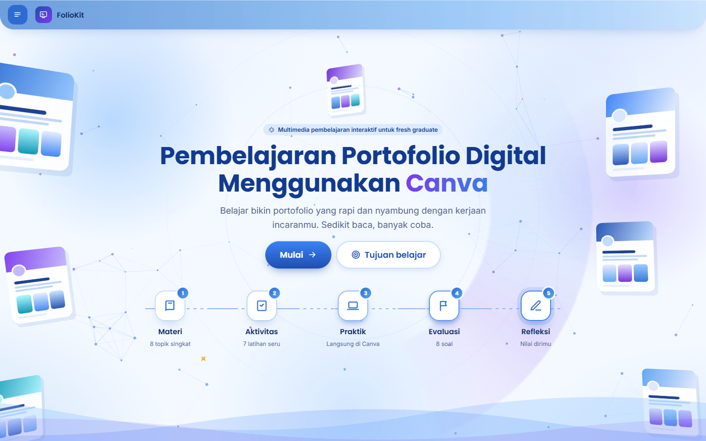

</div>

---

## Daftar isi

- [Tentang](#tentang)
- [Tim pengembang](#tim-pengembang)
- [Alur belajar](#alur-belajar)
- [Isi pembelajaran](#isi-pembelajaran)
- [Fitur pendukung](#fitur-pendukung)
- [Galeri tampilan](#galeri-tampilan)
- [Teknologi](#teknologi)
- [Struktur folder](#struktur-folder)
- [Cara menjalankan](#cara-menjalankan)
- [Catatan](#catatan)

## Tentang

Web ini adalah media belajar mandiri yang membimbing pengguna dari **"portofolio itu apa?"** sampai **punya portofolio jadi di Canva** yang siap dipakai melamar kerja. Prinsipnya: *sedikit baca, banyak coba*. Materi disajikan dalam slide pendek bergaya cerita, diselingi animasi, contoh, dan kuis singkat, lalu ditutup dengan latihan, praktik langsung, evaluasi, dan sertifikat.

Dikembangkan untuk mata kuliah **Pengembangan Multimedia Pembelajaran**, Program Studi Teknologi Pendidikan, Universitas Negeri Jakarta, dengan model pengembangan **Hannafin & Peck**.

## Tim pengembang

**Kelompok 1, Teknologi Pendidikan A, Universitas Negeri Jakarta**

| Nama | Peran |
| --- | --- |
| Arman Fadhilah | Project Manager |
| Bhimo Chrisandy | Desainer Instruksional |
| Rafli Putra Ardi | Desainer Instruksional |

## Alur belajar

Setiap tahap terbuka setelah tahap sebelumnya selesai, jadi pengguna belajar berurutan.

```
Intro → Tes awal → 8 Materi → Peta konsep → 7 Aktivitas → Praktik di Canva → Evaluasi → Refleksi → Rapor & Sertifikat
```

| Tahap | Isi |
| --- | --- |
| 🎬 **Intro** | Video pembuka 53 detik tentang pentingnya portofolio. |
| 🏁 **Tes awal** | 8 soal untuk mengukur pemahaman awal. Nilainya dibandingkan dengan evaluasi akhir. |
| 📖 **Materi** | 8 topik, masing-masing bisa dibaca dalam mode **Cerita** (slide) atau **Ringkasan**. |
| 🗺️ **Peta konsep** | Rangkuman visual semua materi, tiap cabang bisa diklik. |
| ✅ **Aktivitas** | 7 latihan interaktif, boleh diulang sampai benar. |
| 💻 **Praktik** | 4 langkah membuat portofolio sungguhan di Canva, plus mode simulasi. |
| 🚩 **Evaluasi** | 8 soal akhir. |
| ✍️ **Refleksi** | Menilai diri sendiri setelah belajar. |
| ⭐ **Rapor** | Ringkasan progres, kenaikan nilai, lencana, dan sertifikat. |

## Isi pembelajaran

### 8 Materi

| No | Materi | Yang dipelajari |
| --- | --- | --- |
| 1 | Konsep Portofolio Digital | Apa itu portofolio digital, dan kenapa penting buat cari kerja pertama. |
| 2 | Struktur Portofolio Digital | Lima bagian yang hampir selalu ada di portofolio yang enak dibaca. |
| 3 | Menentukan Isi Portofolio | Memilih karya yang paling nyambung dengan pekerjaan yang diincar. |
| 4 | Mengenal Canva | Tampilan Canva dan fitur dasar yang bakal sering dipakai. |
| 5 | Prinsip Dasar Desain | Empat hal yang bikin portofolio terlihat rapi tanpa harus jago desain. |
| 6 | Membuat Portofolio dengan Canva | Urutan kerja dari template kosong sampai portofolio siap diperiksa. |
| 7 | Publikasi Portofolio | Cek ulang, simpan, lalu bagikan ke orang yang tepat. |
| 8 | Evaluasi dan Perbaikan | Cara menilai portofolio sendiri, lalu memperbaikinya satu per satu. |

Setiap materi dilengkapi **gambaran animasi**, **contoh**, **kartu bolak-balik**, **video**, dan **cek cepat**.

### 7 Aktivitas

| No | Aktivitas | Topik |
| --- | --- | --- |
| 1 | Fungsi Portofolio | Konsep |
| 2 | Susun Strukturnya | Struktur |
| 3 | Pilih Karya yang Pas | Studi kasus |
| 4 | Mana yang Lebih Enak Dibaca? | Prinsip desain |
| 5 | Cocokkan Istilah | Istilah kunci |
| 6 | Benar atau Salah | Salah kaprah |
| 7 | Urutkan Langkahnya | Alur kerja |

### 4 Langkah praktik di Canva

1. **Pilih template**: mulai dari kerangka yang sudah rapi.
2. **Isi data dirimu**: ganti teks contoh dengan datamu sendiri.
3. **Masukkan karya**: bagian yang paling dilihat perekrut.
4. **Rapikan tampilan**: maksimal dua jenis huruf, satu warna utama, jarak yang konsisten.

## Fitur pendukung

- 📘 **Contoh portofolio** berbentuk buku 8 halaman, ada **versi benar** dan **versi kurang tepat** lengkap dengan penjelasannya.
- 💬 **Kak Folio**, asisten tanya jawab seputar portofolio dan Canva (51 jawaban bawaan, bisa dipakai offline).
- 🏅 **Sertifikat** penyelesaian yang bisa diunduh sebagai PNG (nilai evaluasi minimal 70).
- 🎖️ **8 lencana** sebagai penghargaan pencapaian.
- 🎨 **Galeri gaya template** Canva.
- 🧭 **Tur panduan** di setiap halaman untuk pengguna baru.
- 🔍 **Pencarian menu** dan halaman **sumber materi**.
- 💾 **Progres tersimpan otomatis** di browser, bisa dicadangkan ke file dan dipulihkan di perangkat lain.
- 🧩 **Terasa seperti aplikasi**: di laptop dan tablet navigasi ada di sidebar kiri (jadi rel ikon di layar sedang), di HP pakai header ringkas.
- 📱 **Responsif**: satu layar tanpa scroll, menyesuaikan HP, tablet, dan laptop.
- 🏠 **Beranda ringkas**: perkiraan durasi tiap langkah, sisa waktu belajar, dan target kecil hari ini yang opsional.
- 🎬 **Video diputar langsung di dalam web**, tanpa pindah tab.
- ✨ **Efek 3D ringan**: kartu portofolio 3D di halaman awal, logo intro berputar, kartu miring mengikuti kursor, dan garis loading antar halaman. Otomatis dimatikan di perangkat lemah atau kalau animasi dikurangi.
- ⌨️ **Bisa dipakai dengan keyboard** (panah kiri/kanan untuk ganti slide, Esc untuk menutup panel).

## Galeri tampilan

| Beranda | Materi (mode Cerita) |
| --- | --- |
| 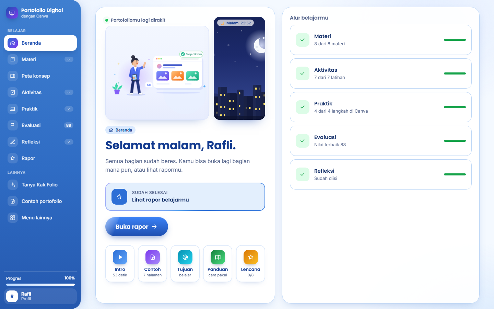 | 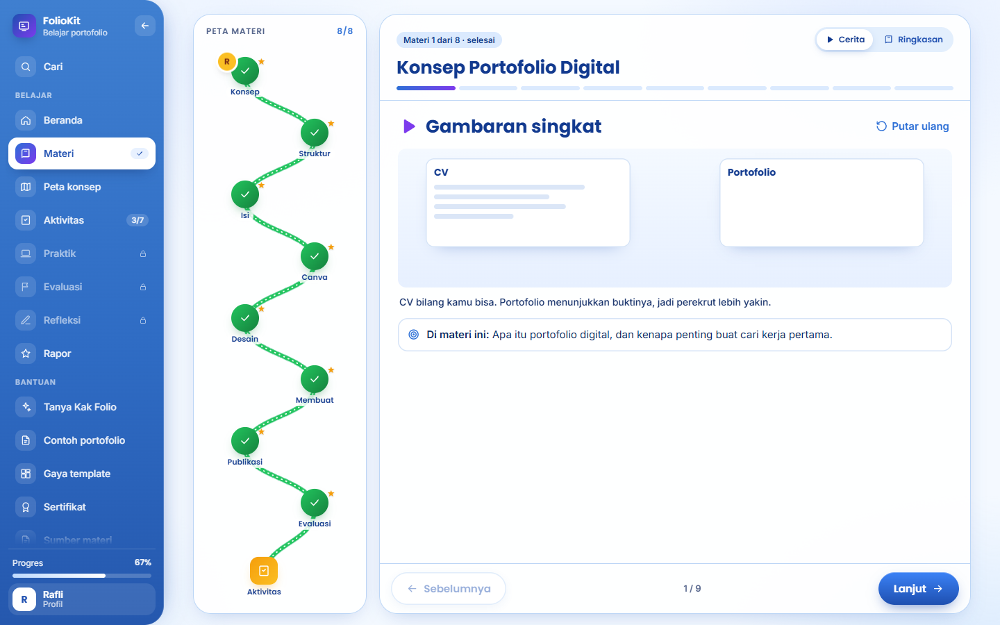 |

| Peta konsep | Daftar aktivitas |
| --- | --- |
|  | 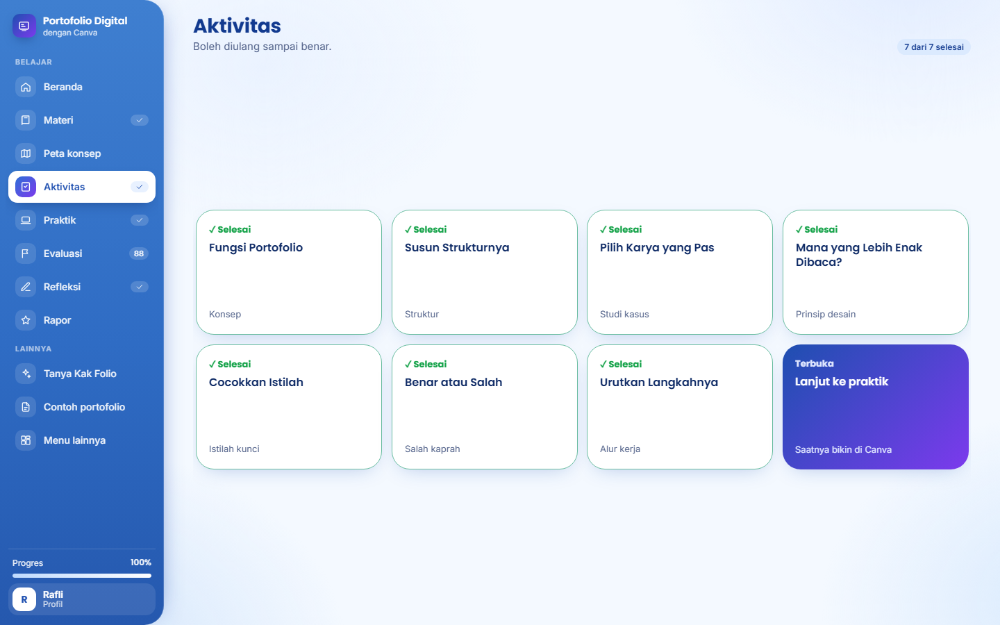 |

| Contoh aktivitas | Praktik di Canva |
| --- | --- |
| 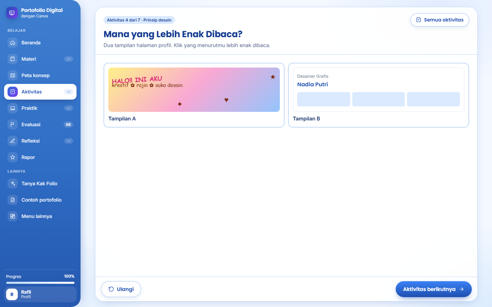 | 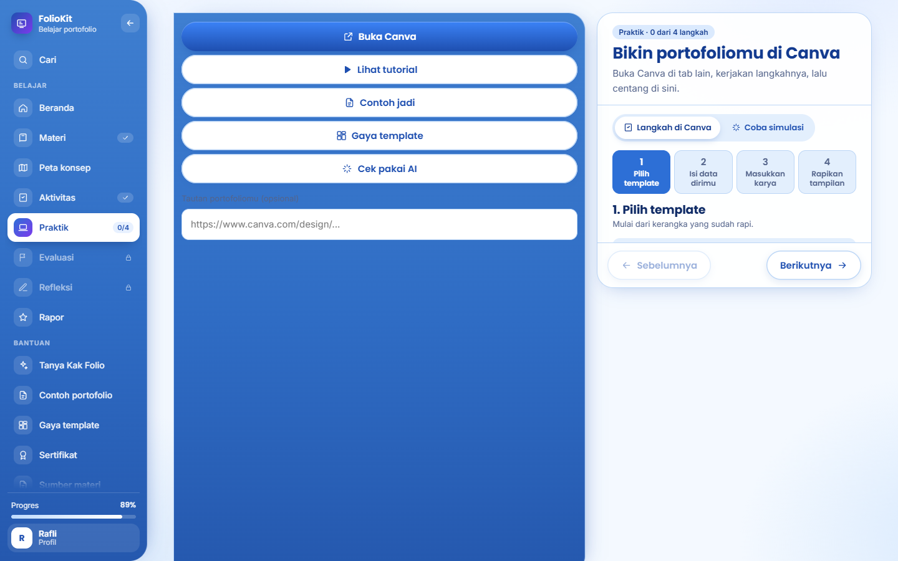 |

| Rapor belajar | Sertifikat |
| --- | --- |
| 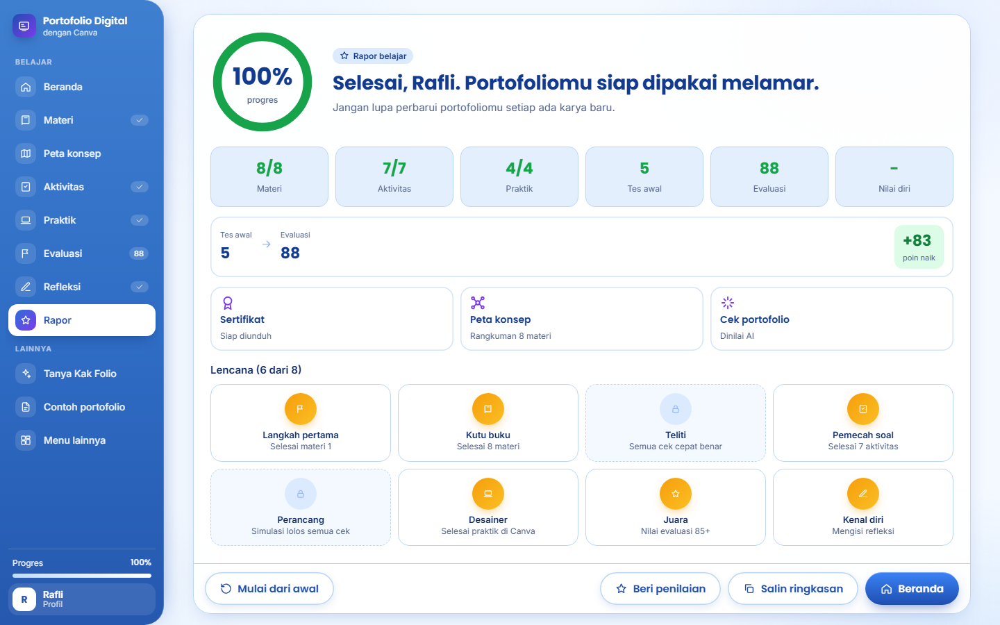 | 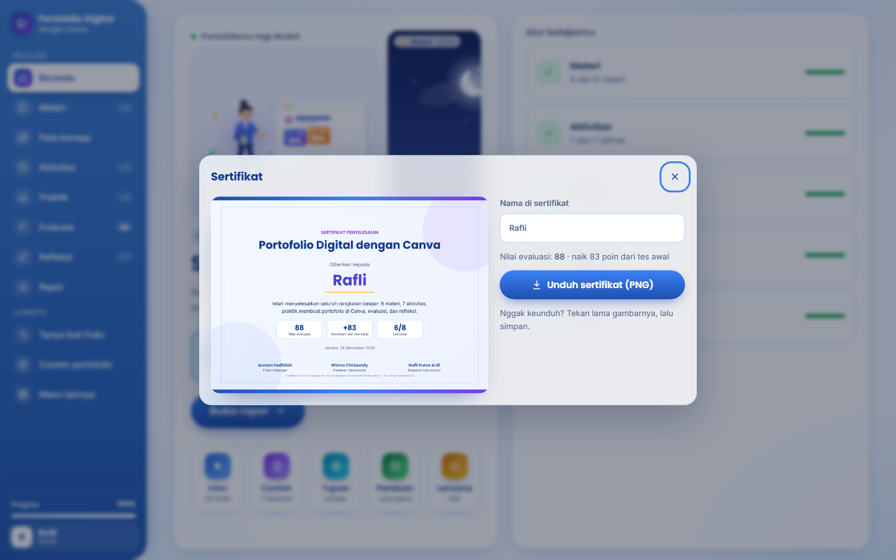 |

| Contoh portofolio | Tanya Kak Folio |
| --- | --- |
| 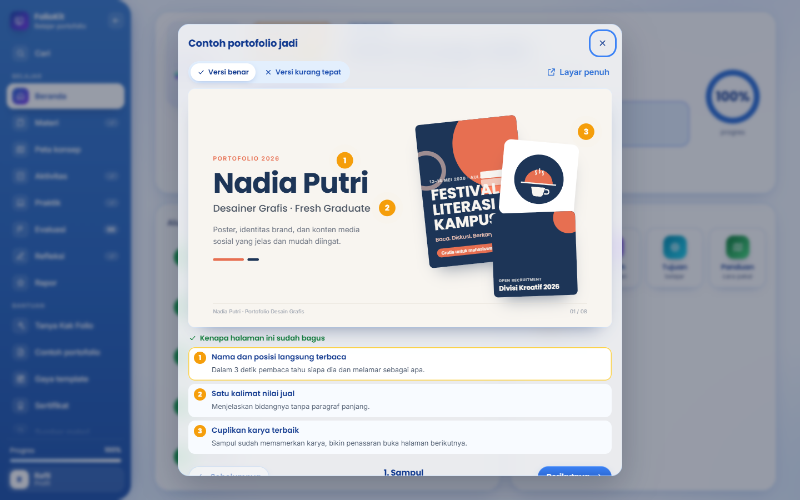 |  |

**Tampilan di HP**

<p>
  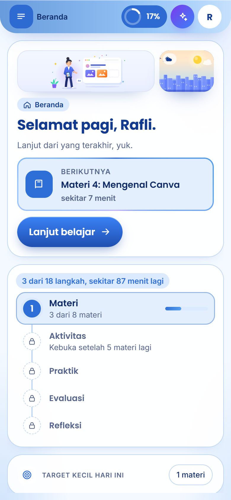
  &nbsp;&nbsp;
  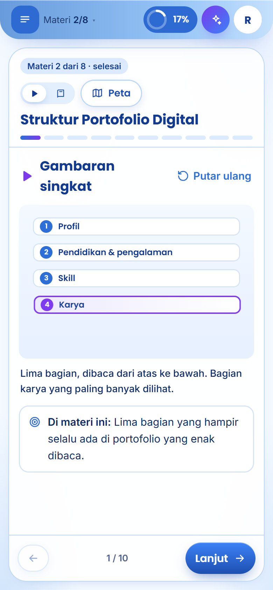
</p>

## Teknologi

- **HTML, CSS, dan JavaScript murni**: tanpa framework, tanpa proses build.
- **Google Fonts**: Poppins dan Inter.
- **Three.js** (MIT): ilustrasi 3D halaman awal, hanya bagian yang dipakai (folder `vendor/`).
- **localStorage**: menyimpan progres belajar di browser.
- **GitHub Pages**: hosting gratis.

## Struktur folder

```
FolioKit/
├── index.html          halaman utama
├── style.css           semua tampilan
├── script.js           semua logika dan isi materi
├── intro.mp4           video intro (53 detik)
├── intro-poster.jpg    gambar sampul video intro
├── vendor/             Three.js versi ringkas untuk ilustrasi 3D
├── tests/              tes otomatis (Playwright)
├── package.json        dependensi untuk tes
├── CLAUDE.md           catatan proyek untuk Claude Code
└── docs/preview/       screenshot untuk README
```

## Cara menjalankan

### Online

Buka 👉 **https://rafkalards.github.io/FolioKit/**

### Di komputer sendiri

1. Download repo ini (**Code → Download ZIP**) atau clone:

   ```bash
   git clone https://github.com/rafkalards/FolioKit.git
   cd FolioKit
   ```

2. Jalankan web server sederhana:

   ```bash
   python -m http.server
   ```

3. Buka `http://localhost:8000` di browser.

### Tes otomatis

Butuh Node.js, Playwright (Chromium), dan Python dengan Pillow:

```bash
npm install
npx playwright install chromium
node tests/flow.js hp     # alur pengguna baru di HP sampai sertifikat
node tests/sweep.js lap   # buka semua layar dan klik semua tombol
```

Daftar lengkap tes ada di [CLAUDE.md](CLAUDE.md).

## Catatan

- Fitur yang memakai layanan Claude (jawaban AI langsung, cek portofolio pakai AI, dan penyimpanan progres ke server) hanya aktif saat dibuka sebagai artifact di claude.ai. Di GitHub Pages, Kak Folio tetap menjawab dari daftar jawaban bawaan.
- Progres disimpan di browser masing-masing. Pakai menu **cadangkan progres** kalau mau pindah perangkat.

---

<div align="center">
Dibuat oleh Kelompok 1 · Teknologi Pendidikan A · Universitas Negeri Jakarta
</div>
